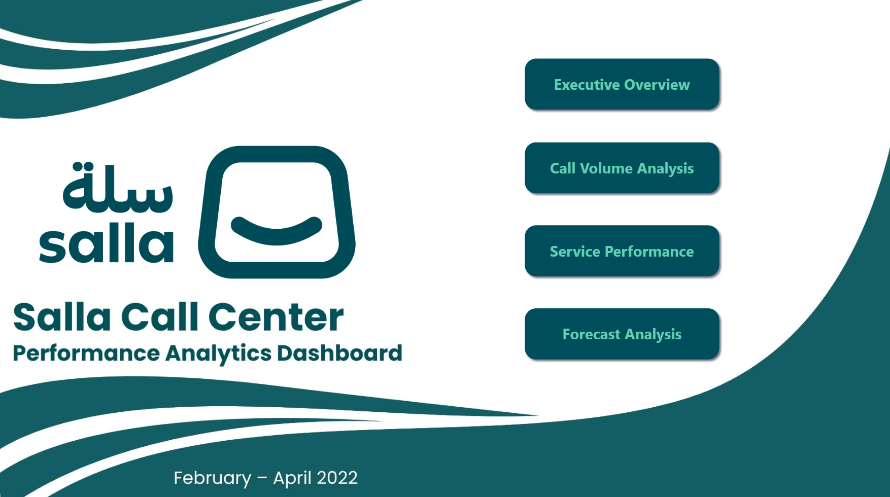
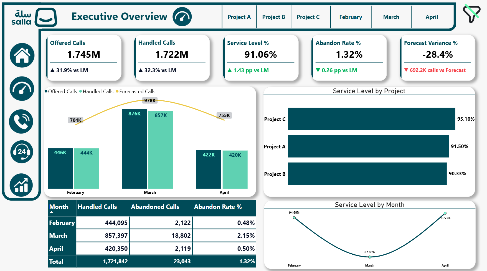
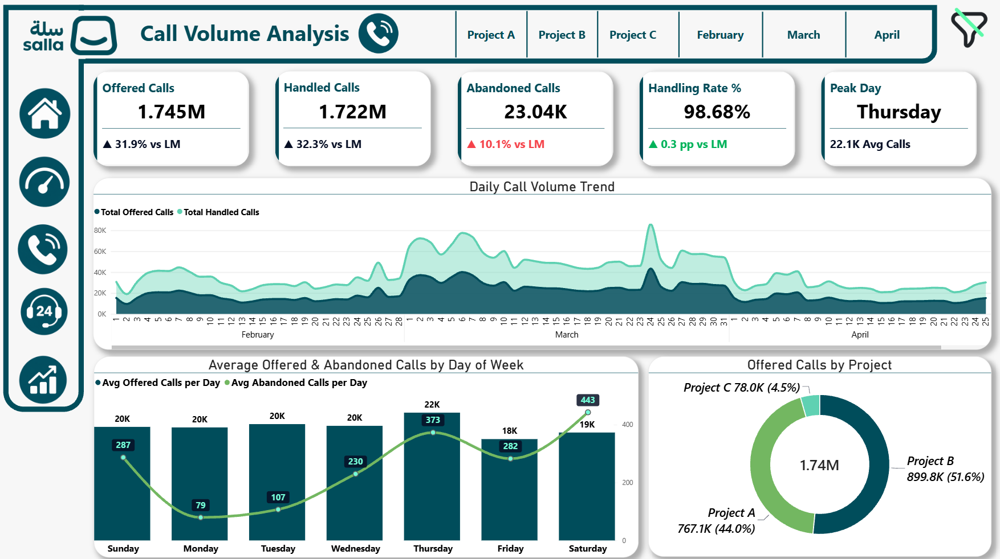
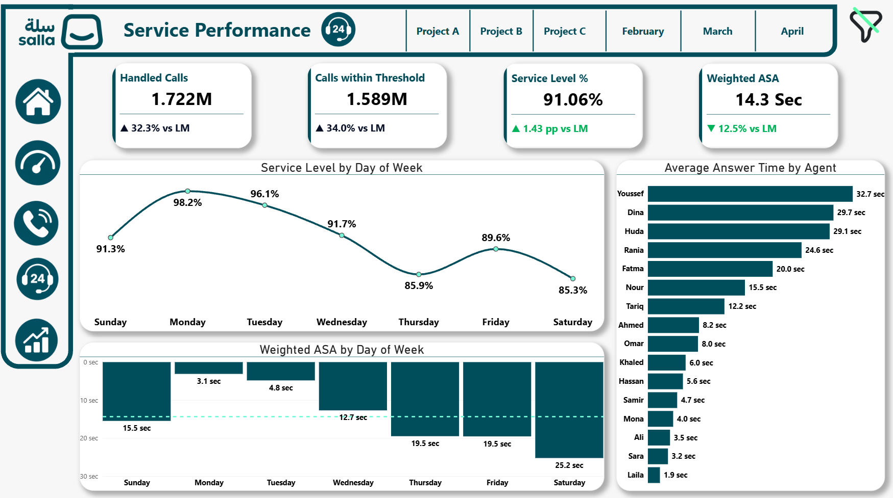
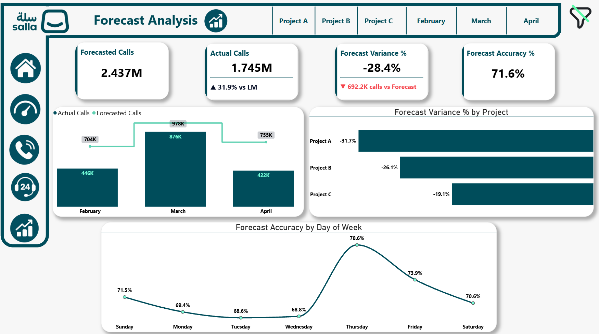

# Salla Call Center Performance Analytics | Power BI

> An independent Power BI data analytics project examining call center demand, handling performance, service quality, and forecasting across **February–April 2022**. This is a portfolio project and is **not an official Salla report** or an indication of affiliation.

## Project overview

This multi-page Power BI report explores call center operations across three project groups (A, B, and C). The report combines an executive overview with call volume, service performance, and forecast analysis, with navigation and slicers for **project** and **month**.

### Key indicators

| KPI | Dashboard value | Interpretation |
| --- | ---: | --- |
| Offered calls | **1.745M** | Total incoming/offered volume |
| Handled calls | **1.722M** | Calls handled by the contact center |
| Abandoned calls | **23.04K** | Offered calls not handled |
| Handling rate | **98.68%** | Handled calls as a share of offered calls |
| Abandon rate | **1.32%** | Abandoned calls as a share of offered calls |
| Service level | **91.06%** | Dashboard's reported threshold-based service level |
| Weighted ASA | **14.3 sec** | Dashboard's reported average speed of answer |
| Forecasted calls | **2.437M** | Planned/forecast offered volume |
| Forecast variance | **−28.4%** | Actual volume below forecast |
| Forecast accuracy | **71.6%** | Dashboard's reported accuracy metric |

*Values reflect the unfiltered dashboard screenshots; rounded headline figures may differ slightly from underlying totals. Validate measure definitions in the `.pbix` before reusing these KPIs operationally.*

## Dashboard pages

### 1. Executive overview

High-level operational view of call volume, service levels, abandonment, monthly movements and comparisons across Projects A, B and C.

### 2. Call volume analysis

Analysis of daily call patterns, weekday demand, handled versus offered calls, and the distribution of demand by project.

### 3. Service performance

Service-level trends by day of week, weighted average speed of answer (ASA), and variation in average answer time by agent.

### 4. Forecast analysis

Comparison of actual and forecast call volume, forecast deviation by project, and weekday forecast accuracy.

## Selected findings from the displayed views

- **March** recorded the highest monthly offered volume (about **876K**) and the lowest monthly service level (**87.06%**), compared with **94.68%** in February and **95.53%** in April. This indicates a period to investigate for capacity-demand alignment; causation is not established by the charts alone.
- **Project B** accounts for the largest share of offered calls (**51.6%**, about **899.8K**) among the three displayed projects.
- **Thursday** has the highest displayed average offered calls by weekday (about **22K**); on the service-level chart, **Saturday** is lowest (**85.3%**). These are different dimensions and should not be treated as direct causal evidence.
- Actual offered volume was approximately **692K calls below forecast** (**−28.4%**). The model's forecast methodology is not documented in the screenshots.

## Tools and analysis areas

- **Power BI** — interactive dashboards, filters, cross-page navigation and KPI reporting
- **CSV source files** — monthly contact-center datasets (February, March and April)
- **Analysis themes** — call demand, service level, abandoned calls, ASA and forecast variance

## Report file and data

The original Power BI report and datasets may be added to this repository after a review of **data ownership, sharing permissions and any agent/customer personal information**. Screenshots are included here to allow browser-based viewing without installing Power BI Desktop.

## Notes on interpretation

- **Service level** depends on the threshold and denominator defined in the source model; verify both in the DAX measures.
- **Forecast accuracy** is shown as **71.6%** in the report; different forecasting disciplines define accuracy differently.
- Screenshot-based observations are descriptive and do not establish root causes of performance changes.
- Agent-level visuals can expose identifying information. Check publication permissions before making the report or source data public.

---

**Project type:** Independent analytics portfolio case study  
**Period displayed:** February–April 2022  
**Tool:** Microsoft Power BI
